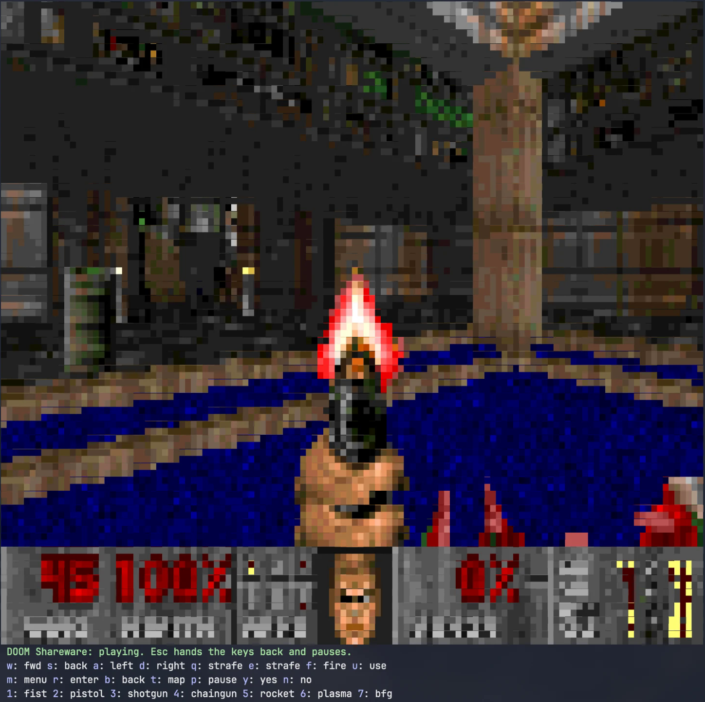

# doom-pane

The original DOOM in a Claude Code pane, with nothing to install. The engine is id Software's, by way of
[doomgeneric](https://github.com/ozkl/doomgeneric), compiled to plain JavaScript and run **inside the mod's hooks
module**: no native binary, no sidecar process, no compiler, no download, no network. The game data ships with the
plugin: id Software's shareware episode of DOOM ("Knee-Deep in the Dead", E1M1 and all), and
[Freedoom Phase 1](https://freedoom.github.io/) beside it. Install it, type `/doom`, play. It is the same on
Windows, macOS and Linux, because nothing of it touches the machine beyond Claude Code's own plugin API.



The picture is a `Raster` of half-block cells (one terminal cell holds two pixels, truecolor) repainted with
`$.ui.blit`; the keys are the pane's hotkeys. Your own IWADs (`doom.wad`, `doom2.wad`, Final DOOM) play too, see
"Your own IWAD".

## Play

`/doom` opens the pane with the keyboard and starts the shareware DOOM (or the IWAD you played last). `w` `s` move, `a` `d`
turn, `q` `e` strafe, `f` fires, `u` uses (doors, switches), `m` opens the menu, `r` is Enter, `b` is Backspace, `t`
toggles the automap, `p` pauses, `y` `n` answer the menu, `1`-`7` pick a weapon. Running is always on (the terminal
has no Shift hotkey). Esc hands the keys back to the prompt and pauses the game; a click on the pane (or ctrl+x, then
Tab) resumes it.

| Command | Does |
|---|---|
| `/doom` | opens the pane and the game; again closes the pane, the game keeps its state |
| `/doom new` | restarts the current IWAD from its title screen |
| `/doom wads` | lists the IWADs: the bundled shareware DOOM and Freedoom, then your own |
| `/doom <name>` | plays one of them (`/doom freedoom1`, `/doom doom2`) |
| `/doom help` | prints the keys |

Saving from DOOM's menu puts the slot in the plugin store, and the next start mounts it back, so the load menu works
across sessions. Each IWAD has its own slots.

## Install

```
/plugin marketplace add speti4/claude-games
/plugin install doom-pane@claude-games
```

Then `/doom`. The plugin is about 35 MB, most of it the game data (4 MB shareware DOOM, 28 MB Freedoom).

## Your own IWAD

The mod reads files through `$.fs.read`, which rejects a file over 4 MiB, so an IWAD goes into a folder of its own
under `~/.claude/doom-wads/` (the `wadDir` option names another folder), split into 2 MiB parts. The folder's name is
the IWAD's name (`doom2` for `doom2.wad`), the parts are joined in name order, and any `.txt` beside them is
ignored. No tool is needed beyond the shell:

```powershell
# Windows (PowerShell)
$src = "C:\Games\DOOM\doom2.wad"; $dst = "$env:USERPROFILE\.claude\doom-wads\doom2"
New-Item -ItemType Directory -Force $dst | Out-Null
$bytes = [IO.File]::ReadAllBytes($src); $n = 0
for ($o = 0; $o -lt $bytes.Length; $o += 2MB) {
  $len = [Math]::Min(2MB, $bytes.Length - $o); $part = New-Object byte[] $len
  [Array]::Copy($bytes, $o, $part, 0, $len)
  [IO.File]::WriteAllBytes("$dst\part-$($n.ToString('000')).bin", $part); $n++
}
```

```bash
# macOS, Linux
mkdir -p ~/.claude/doom-wads/doom2 && split -b 2m doom2.wad ~/.claude/doom-wads/doom2/part-
```

Then `/doom wads` lists it and `/doom doom2` plays it. The registered games are your own copies; only the shareware
episode is included.

## The picture and its pace

The engine runs at DOOM's 35 tics a second, one tic per timer tick, on a virtual clock. The view keeps 4:3 and fills
the pane's width (a 160-column dock gives 160×60 cells, 160×120 pixels), sampled nearest-neighbour from the engine's
320×200 frame, so a smaller terminal font and a wider dock (drag its edge) mean a sharper picture. Frames go to the
terminal at most `maxFps` times a second (20 by default), within a budget of 100,000 cells a second, and an unchanged
frame is not sent. A frame the terminal is slow to take halves the rate (down to 5 a second); a run of quick ones
brings it back. `maxCells` caps the view when a big one is too coarse at its slower rate. No sound.

## Options (`/config`, then `/reload-plugins`)

| Option | Default | Meaning |
|---|---|---|
| `wadDir` | `~/.claude/doom-wads` | the folder holding one sub-folder per IWAD of your own |
| `alwaysRun` | on | hold DOOM's run key for you |
| `maxFps` | 20 | at most this many frames a second to the terminal (1-35) |
| `maxCells` | empty | cap the picture at this many cells (columns × rows); empty: whatever the pane holds, up to 512×256 |

## Requirements

- Claude Code 2.1.287 or later (mods); written and tested against 2.1.296. The mods API may change between
  releases.
- A terminal with truecolor and the block elements in its font, at least about 110 columns wide for a playable
  picture. Tested in Windows Terminal (PowerShell and Git Bash).
- Nothing else: no Node, no compiler, no network, no process beyond Claude Code's own.

## Known limitations

- No sound (no sound module is compiled in, and `$.audio` is silent on Windows).
- No mouse and no arrow keys yet: the keys are the pane's hotkeys, lowercase letters and digits. A `Client` module
  for arrows and the mouse is planned for 0.2.0.
- A terminal cannot report a key release, so a held key is simulated: the first press keeps the key down for 550 ms
  (past the OS repeat delay), each repeat extends it by 120 ms. Movement stops a moment after you let go.
- A large view is coarse in motion (the frame rate drops to keep the terminal responsive); a smaller dock is
  smoother. Lower `maxFps` or set `maxCells` if Claude Code itself stutters while the game runs.
- A hot reload of the plugin drops the running game; the status line says so and `/doom` starts it again.
- The half block (U+2580) is an ambiguous-width glyph; a CJK terminal set to draw such glyphs wide will break the
  grid.
- `/doom bench` is a developer command: it runs the engine for 350 tics and reports the cost per tick and per frame.

## How it works, and how the other ports do

A Claude Code hooks module runs in a sandbox without Node, a DOM or WebAssembly, so the engine is doomgeneric
compiled with Emscripten's wasm2js to plain JavaScript (713 KB) and imported like any module. The platform layer is
five functions: a virtual clock the tick advances, a key queue the hotkeys fill, a frame flag, the title, and the
save callback into the plugin store. The 320×200 frame is packed into Raster cells by a pure module and blitted.

Every other DOOM for Claude Code known to the author runs the engine outside the sandbox and needs something of the
machine: a native doomgeneric binary started with `$.process.spawn` ([clawd-doom](https://github.com/StudentOcd/clawd-doom),
[reporails/arcade](https://github.com/reporails/arcade), [martinzokov/claude-doom](https://github.com/martinzokov/claude-doom),
[ChaseWNorton/claude-doom](https://github.com/ChaseWNorton/claude-doom)), a bun or node sidecar loading a WASM build
([slop-doom](https://github.com/wobondar/claude-plugins)), doom-cli in tmux ([claudoom](https://github.com/MadAppGang/magus-alpha)),
an Odamex deathmatch client ([intermission](https://github.com/jarrodwatts/intermission)) or a daemon behind the status
line ([doom-in-claude-code](https://github.com/erkandogan/doom-in-claude-code)). They were all there first; this one
is the one with nothing to install.

## Develop

```powershell
claude --debug --plugin-dir .\doom-pane            # trial session, hot reload on save
claude plugin validate .\doom-pane
npx -p typescript tsc -p .\doom-pane               # typecheck (the first --plugin-dir load writes the types)
claude plugin test .\doom-pane                     # every tests/*.test.ts
node .\doom-pane\tools\check-bundle.mjs            # the bundled parts add up, the engine starts on them (Node)
```

`hooks/engine/doomgeneric.js` is committed; rebuilding needs Docker and Node:

```bash
tools/build-engine.sh           # clones doomgeneric at the pinned commit, patches, emcc in emscripten/emsdk:6.0.12, post-processes
tools/build-engine.sh --debug   # -O1 with assertions
node tools/bundle-wads.mjs shareware   # re-fetches doom19s.zip from the idgames archive, verifies it, splits DOOM1.WAD into wads/doom1/
node tools/bundle-wads.mjs freedoom    # the same for the Freedoom release into wads/freedoom1/
```

See `THIRD-PARTY.md` for what is compiled in, where the data comes from and under which licences.

## Layout

```
hooks/register.tsx          the hooks: /doom, the pane, the 35 Hz tick, the frame pacing, the hotkeys, the saves
hooks/pane.tsx              the pane's tree: Raster, status line, legend of hotkey Buttons
hooks/cells.ts              pure: a 0x00RRGGBB frame → half-block Raster cells, base64
hooks/view.ts               pure: the 4:3 view that fits the pane, the cell cap, the frame budget
hooks/keys.ts               pure: the bindings, DOOM key codes, the hold synthesizer
hooks/wad.ts                pure: a WAD folder's plan (with or without a manifest), the parts, the IWAD header
hooks/engine/driver.ts      one running game over the engine module: create, tick, keys, frame, exit
hooks/engine/doomgeneric.js the engine (generated, GPL-2) and its hand-written .d.ts
wads/doom1/                 the shareware DOOM in 2 MiB parts, its manifest, README and licence note
wads/freedoom1/             Freedoom Phase 1 in 2 MiB parts, its manifest and licence
tools/                      build-engine.sh, postprocess.mjs, bundle-wads.mjs, check-bundle.mjs, dg-platform.c, dg-library.js, patches/
types/index.d.ts            the $.state contract (status)
tests/                      claude plugin test: the pure modules, the engine's load and exit, the command and the pane
```

Pure API: `$.ui`, `$.store`, `$.state`, `$.clock`, `$.fs` reads (the plugin's own folder and `wadDir`), `$.env`
reads of HOME and USERPROFILE. No sound, no network, no processes, no writes.

## Credits and licence

- [id Software](https://github.com/id-Software/DOOM) for DOOM: the engine, released under the GPL in 1997, and the
  shareware episode, released for free copying in 1993.
- [doomgeneric](https://github.com/ozkl/doomgeneric) by Ozkan Sezer, the portable DOOM this runs, built on
  [Chocolate Doom](https://www.chocolate-doom.org/).
- [Freedoom](https://freedoom.github.io/), the free game data, by its contributors.
- [Emscripten](https://emscripten.org/), whose wasm2js makes a C engine a JavaScript module.

The plugin is GPL-2.0: `LICENSE` is the licence text, `COPYRIGHT` the copyright lines and what the GPL does not
cover. The shareware episode is id Software's, unmodified, under its shareware
terms: free to copy, not to sell or modify (`wads/doom1/LICENSE.txt`, `wads/doom1/README.TXT`). Freedoom is
BSD-3-Clause (`wads/freedoom1/COPYING.txt`). The details are in `THIRD-PARTY.md`. DOOM is a trademark of id
Software LLC, a ZeniMax Media company. This plugin is not affiliated with or endorsed by id Software, ZeniMax,
Anthropic or the Freedoom project.
